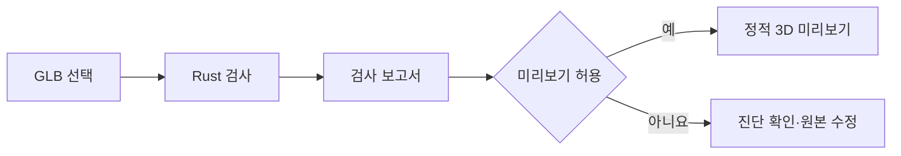

# 검사와 미리보기의 역할

Rigloom은 모델을 수정하기 전에 파일 구조와 처리 가능 범위를 확인합니다. 현재 구현은 이 검사와 정적 미리보기까지입니다. 화면에 모델이 나타난다는 사실만으로 자연스럽게 움직이는 휴머노이드나 유효한 VRM이 되지는 않습니다.

검사기는 원본 바이트를 바꾸지 않습니다. 파일 구조와 지원 정책을 확인해 보고서를 만들고, 허용된 파일을 뷰어에 전달합니다. 뷰어는 표시를 위한 별도 해석을 수행하므로 렌더링에서 실패해도 이미 생성한 검사 보고서는 남습니다.

## 리깅·스키닝과의 차이

뼈대와 관절의 의미를 정하는 작업, 정점이 각 본을 얼마나 따를지 정하는 스키닝, 움직임을 확인하고 보정하는 작업은 서로 다른 단계입니다. 현재 스킨 목록은 이미 들어 있는 스킨의 존재를 알려 줄 뿐, 그 관계나 가중치를 검증·수정하지 않습니다.

장기적으로 Rigloom은 좋은 기존 리그와 가중치를 보존하면서, 뼈대가 없는 표면에는 관절 배치와 스키닝을 제공하는 것을 목표로 합니다. 비정상적인 비율도 캐릭터 이름별 예외 없이 다룹니다. 이 목표의 기준은 [제품 요구사항](../../specs/product/requirements.md)에 있으며 현재 사용 가능한 기능으로 해석해서는 안 됩니다.

VRM 파일의 유효성과 자연스러운 변형도 별개입니다. PBR 재질이 자동으로 MToon이 되거나 표정·시선·물리가 자동으로 생기지 않습니다. 모델 변환은 원본의 권리를 바꾸지 않으며, 권리를 알 수 없다고 자유 이용으로 간주하지 않습니다.

## 브라우저 안의 처리

Rust 검사는 WASM으로 한 개의 Worker에서 실행됩니다. 취소나 새 파일 선택은 이전 Worker를 종료하고, 이전 응답이 최신 결과를 덮어쓰지 못하게 합니다. 미리보기를 위한 파싱·렌더링은 메인 스레드에서 수행하므로 큰 파일에서 화면 응답이 느려질 수 있습니다.

현재 모델 업로드 서비스, 원격 측정, 외부 런타임 CDN은 설정하지 않았습니다. 버퍼·이미지 URI는 뷰어로 전달하기 전에 차단합니다. 네트워크 검증은 생성된 합성 입력을 대상으로 하며 모든 파일·향후 통합·배포에 대한 보편적인 보장은 아닙니다. 개발 환경 설치에는 의존성 다운로드가 필요합니다.

Rigloom은 표준 아바타 준비 도구이고 [drum-vrm](https://github.com/postmelee/drum-vrm)은 음악에 맞춘 연주를 담당하는 별도 프로젝트입니다. Rigloom은 drum-vrm 전용 VRM 형식이나 캐릭터별 변환 규칙을 목표로 하지 않습니다.
