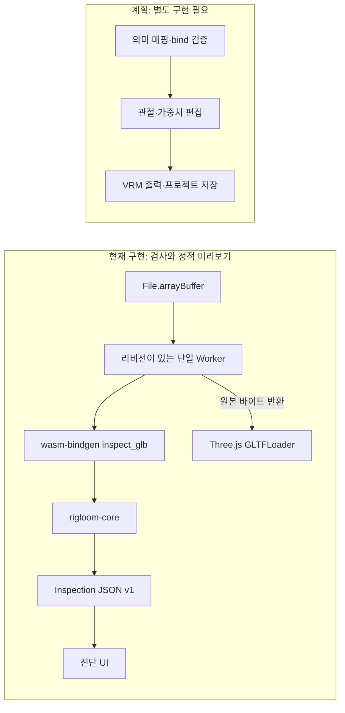

# 엔진과 브라우저 경계

## 현재 구현

읽기 전용 검사와 정적 미리보기를 구현했습니다. 변환·리깅 작업은 아래의 별도 계획 경계입니다.

| 경계 | 책임 |
|---|---|
| `rigloom-core` | 불변 바이트 입력, GLB 프레이밍, gltf 1.4.1 스키마·참조, 확장·URI·sparse 정책, buffer/accessor 범위, 노드 트리, 유한 좌표·토폴로지, 메시·노드·skin 목록, 구조화한 진단 |
| `rigloom-wasm` | 네이티브 보고서를 JSON으로 직렬화. 파일시스템·네트워크 import 없음. 스키마 버전으로 호환 경계 표시 |
| Worker | 한 작업씩 계산. ArrayBuffer 소유권을 받고 돌려줌. 취소·교체 시 동기 WASM을 포함한 Worker 종료와 리비전 증가. 읽기·검사·미리보기 준비 단계 제공 |
| UI·Viewer | 정적 장면·스켈레톤, 앞/옆/자유 시점·회전, 테마, 입력·보고서, 안전한 텍스트 진단. 오래된 비동기 장면 폐기와 이전 자원 해제 |

Rust가 해석의 권위를 가지며 렌더러는 변환 엔진이 아닙니다. URI guard와 같은 출처의 운영 CSP는 Rust의 자원 정책을 보완합니다. Vite 개발 CSS 주입을 위한 inline-style 허용은 개발 HTML 변환에만 적용하고 정적 빌드는 같은 출처 스타일을 유지합니다. 원본 바이트는 재작성하지 않습니다. 업로더·CDN·분석 수집·백엔드·공유 메모리·출력기·편집기는 없습니다.

## 계획된 M1/M2 데이터 경계

다음은 아직 구현된 구조체가 아닌 설계 계약입니다. #4·#7·#10의 실제 필요에 맞춰 정의하며 미사용 추상화를 먼저 만들지 않습니다.

| 계약 | 보존할 정보 |
|---|---|
| `SourceDocument` | 원본 리소스, 장면·skin 식별자, 원본 해시 |
| `RigDefinition` | 의미 휴머노이드 키, 부모 관계, 로컬 rest 변환, 바인딩 |
| `RigEdit` | 모델 좌표계의 사용자 편집 의도 |
| `SkinSolution` | 정규화 영향도, 잠금 영역, 알고리즘·설정, 원본·리그 리비전 |
| `ConversionReport` | 파일 유효성, 변경 내용, 변형 우려의 분리 |

매핑·배치·가중치는 DOM, 메시·캐릭터 이름에 의존하지 않습니다. Three.js 객체는 렌더러 어댑터에 두고 안정적인 glTF 인덱스만 경계를 넘깁니다. 편집 명령은 취소/재실행을 지원하며 원본·리그 리비전 변경은 가중치·미리보기·대기 응답을 무효화합니다. rest 포즈, 노드 변환, inverse bind를 하나의 좌표계로 평가하고 방향·단위 변경을 일관되게 전파하거나 거부합니다.

프로젝트는 원본 식별, 매핑, 변환, 배치, 가중치·설정·보정의 버전을 관리합니다. 원본 누락과 스키마 마이그레이션 실패는 명시적 오류입니다. 출력은 필수 VRM 메타데이터·휴머노이드 참조를 독립 검증하고 애니메이션·재질·자원 처리 결과를 보고합니다. 렌더링된 장면만으로 VRM을 재구성하지 않습니다.

## 검사 한계

`preview_allowed`는 정적 표시를 시도해도 된다는 뜻입니다. 한 사람 감지, skin 인덱스·가중치·bind 적합성, 모든 입력의 Three.js 표시 성공을 보장하지 않습니다. 렌더링 실패에도 검사 보고서는 유지합니다.

메인 스레드의 파일 읽기·glTF 파싱·렌더링, WASM 복사와 JSON 직렬화는 메모리·응답성 비용입니다. 완전한 행렬 배치 검증, 이미지 디코딩, 깊은 트리, 메모리 한도, 악성 입력 강화는 후속 검증 범위입니다. 대표 브라우저 측정 없이 임의 크기 제한을 제품 표준으로 제시하지 않습니다. 중량이 큰 향후 리그·가중치 계산은 Worker에 둡니다.
